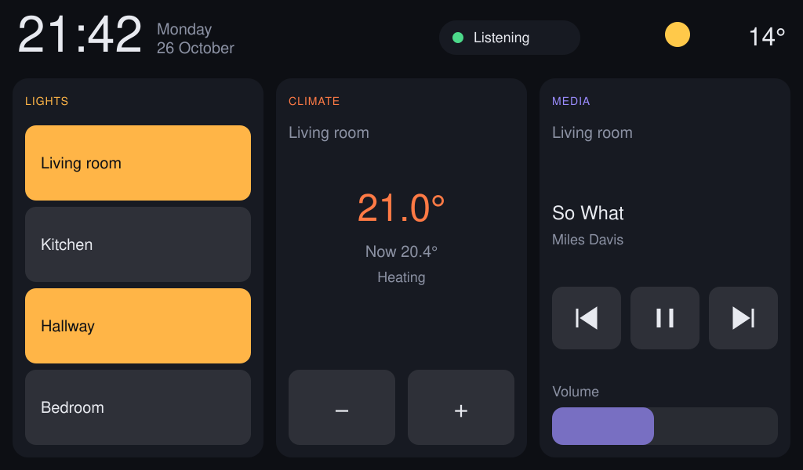

# CrowPanel HA

[](https://github.com/vespassassina/crowpanel-ha/actions/workflows/build.yml)

ESPHome firmware that turns the **Elecrow CrowPanel Advanced 9.0" (ESP32-P4)** into a
Home Assistant wall panel and voice assistant. No custom integration: the panel talks to
HA through the standard ESPHome integration.

Everything on the board works: the screen, touch, backlight, Wi-Fi, **the speaker and the
microphone**. The panel listens for a wake word, sends your voice to HA's Assist, and
speaks the answer.



*The example dashboard, drawn at the panel's 1024 x 600.*

## Contents

- [What works](#what-works)
- [The hardware](#the-hardware)
- [Microphone and speaker](#microphone-and-speaker)
- [Build and flash](#build-and-flash)
- [Add it to Home Assistant](#add-it-to-home-assistant)
- [Voice assistant](#voice-assistant)
- [Make the dashboard yours](#make-the-dashboard-yours)
- [Troubleshooting](#troubleshooting)
- [Repository layout](#repository-layout)

## What works

| Part | Status | Notes |
|---|---|---|
| 9" 1024 x 600 MIPI-DSI display | works | LVGL, any rotation |
| GT911 touch | works | tap wakes the screen |
| Backlight | works | dimmable, in HA as a light |
| Wi-Fi (ESP32-C6 over SDIO) | works | stock C6 firmware, no reflash |
| Speaker (NS4168 amp) | works | TTS replies, announcements, any HA media |
| Microphone (PDM MEMS) | works | wake word and speech-to-text from a few metres |
| Wake word | works | on the panel, with microWakeWord |
| Voice assistant | works | HA Assist: local intents, optional LLM |
| Timers | works | "set a timer for 5 minutes" rings on the panel |
| Screen sleep | works | off after 60 s, on with a touch or the wake word |
| Bluetooth (C6) | not used | |
| Battery charging | hardware only | the board runs from the battery, nothing in firmware |

Tested on hardware V1.2 with an engineering-sample P4 (revision v1.3), ESPHome 2026.10.0
and Home Assistant 2026.10.

## The hardware

The CrowPanel Advanced 9.0" carries two chips:

- **ESP32-P4**, the main processor: display, touch, audio, ESPHome. No radio.
- **ESP32-C6**, the radio: Wi-Fi 6 and BLE, reached by the P4 over SDIO through
  `esp32_hosted`. It ships with firmware that works as it is.

### Hardware versions

Elecrow changed the SDIO wiring between V1.0 and V1.1:

| Board | D0 | D1 | D2 | D3 |
|---|---|---|---|---|
| V1.0 | GPIO14 | GPIO15 | GPIO16 | GPIO17 |
| V1.1, V1.2 | **GPIO17** | **GPIO16** | **GPIO15** | **GPIO14** |

This repo uses the V1.1/V1.2 order. Elecrow's own ESPHome example still has the V1.0 order,
and a V1.1 board boot-loops on it. The version is printed on the back of the board. For a
V1.0, swap the four pins in `packages/hardware.yaml`.

### Chip revision

Early P4 chips (revision below v3.0) are **engineering samples**, and many of these panels
ship with one. An image built for the wrong kind does not boot. Check before the first
flash, with the board on the native USB port (see [Ports](#ports)):

```bash
esptool --chip esp32p4 chip-id
```

The output names the revision, for example `ESP32-P4 (revision v1.3)`.

- Revision **below v3.0**: build with `engineering_sample: "true"`.
- Revision **v3.0 or above**: keep the default, `"false"`.

A wrong guess does not brick anything: the image does not boot, and you flash again with
the other setting.

### Ports

The board has two USB-C ports:

| Port | Chip | Use |
|---|---|---|
| **J1**, labelled UART | CH340K bridge to UART0 | logs, Improv Wi-Fi setup |
| the other one | P4 native USB | first flash (ROM download mode) |

- The battery keeps the board powered, so the usual DTR/RTS auto-reset does nothing.
  Press **RESET (K4)** when a tool waits for the chip.
- Only one program can hold a serial port at a time. Close the log viewer before you flash
  or use ESPHome Web.

### Pins

| Function | Pins |
|---|---|
| Display | MIPI-DSI, reset GPIO41, PHY power from LDO channel 3 at 2.5 V |
| Touch (GT911) | I2C SDA GPIO45, SCL GPIO46, reset GPIO40, interrupt GPIO42 |
| Backlight | power switch GPIO29 (high = on), PWM GPIO31 at 30 kHz |
| Wi-Fi (C6, SDIO) | CLK GPIO18, CMD GPIO19, D0-D3 GPIO17/16/15/14, reset GPIO32 |
| Speaker (NS4168) | I2S LRCLK GPIO21, BCLK GPIO22, DOUT GPIO23, amp enable GPIO30 (low = on) |
| Microphone (PDM) | CLK GPIO24, DATA GPIO26 |
| "Mic R-L" | GPIO20, keep low |

The display controller is the EK79007. ESPHome 2026.10 has no Elecrow model, but the
Waveshare ESP32-P4 7B uses the same panel, so `model: WAVESHARE-ESP32-P4-WIFI6-TOUCH-LCD-7B`
gives the right timings.

## Microphone and speaker

Both work, and well enough for a voice assistant across a room. Getting there took some
digging, so here is what matters.

**No codec.** The board carries an ES8311 DAC and an ES7210 ADC, but on V1.2 their I2S lines
sit behind unfitted resistors. They do nothing. The P4 drives the amplifier and the mic
directly over I2S, which ESPHome's `i2s_audio` supports.

**Speaker.** An NS4168 class-D amplifier on I2S, mono, at whatever rate the stream needs.
Its enable pin, GPIO30, is active low. Left on, the amp hisses, so `packages/audio.yaml`
switches it on when sound starts and off 500 ms after the media player goes idle.
The speaker is a `media_player` in HA: TTS, announcements, alarms, radio streams.

**Microphone.** One PDM MEMS mic: clock on GPIO24, data on GPIO26, left channel, 16 kHz,
16-bit. Things to know:

- **It is quiet.** Elecrow's own samples multiply every sample by 10. Here
  `gain_factor: 8` feeds the wake word and the voice assistant, and `auto_gain: 31dBFS`
  plus `noise_suppression_level: 2` clean it up. Tune `mic_gain` if your room differs.
- **The right channel is noise.** There is one mic; use `channel: left`.
- **GPIO20 must stay low.** Some Elecrow samples drive it high as "Mic R-L". High adds
  noise and the mic stops responding. The `Mic Select` switch exists, disabled, only
  to hold it low.
- **GPIO24 is also the native USB-Serial-JTAG.** ESPHome warns about it. It does no harm
  while logs go over J1.
- `correct_dc_offset: true` removes the PDM offset.

**Check it works.** HA gets a `Mic Level` sensor in dBFS, updated every second. A quiet
room reads around -60; talking at a metre lifts it a few dB; the panel's own speaker at
full volume lifts it about 20 dB. If it never moves, the mic is not being read.

**One mic means no beamforming.** Speak towards the panel from a few metres at most.
Say the wake word, pause half a second, then the command. Without the pause the speech
recogniser hears the tail of the wake word and mishears the rest.

## Build and flash

### What you need

- Python 3.11 or later.
- ESPHome 2026.10.0 or later. Older versions lack parts of the P4 support.
- A USB-C data cable.
- Home Assistant with the ESPHome integration.

```bash
git clone https://github.com/vespassassina/crowpanel-ha.git
cd crowpanel-ha
python3 -m venv .venv
.venv/bin/pip install -r requirements.txt
```

The ESPHome add-on or dashboard in HA works too: copy `crowpanel-ha.yaml`, `packages/`,
`include/` and `fonts/` into your `esphome/` folder there.

### Secrets

```bash
cp secrets.example.yaml secrets.yaml
openssl rand -base64 32
```

Put the random string in `api_key`, and set `ota_password` and `fallback_password` to
anything you like (8+ characters for the fallback). `secrets.yaml` is gitignored.

### Settings

Open `crowpanel-ha.yaml`. Everything you need to change is in `substitutions` at the top:

| Substitution | Default | What |
|---|---|---|
| `name` | `crowpanel-ha` | hostname and device name; one per panel |
| `friendly_name` | `CrowPanel` | name in HA |
| `engineering_sample` | `"false"` | `"true"` for a P4 below revision v3.0 |
| `rotation` | `"0"` | `180` if the panel hangs upside down |
| `idle_timeout` | `60s` | screen off after this long without a touch |
| `weather_entity` | `weather.forecast_home` | weather icon and outside temperature |
| `light_1` ... `light_4` | `light.living_room` ... | the four light buttons |
| `light_1_name` ... | `Living room` ... | their labels |
| `climate`, `climate_name` | `climate.living_room` | thermostat card |
| `media`, `media_name` | `media_player.living_room` | media card |
| `wake_word` | `okay_nabu` | also `hey_jarvis`, `hey_mycroft`, `alexa` |
| `mic_gain` | `8` | microphone gain for wake word and speech |

Any HA entity id works; the defaults are only examples. You can also override them on the
command line, `esphome -s rotation 180 compile crowpanel-ha.yaml`.

### Build

```bash
.venv/bin/esphome compile crowpanel-ha.yaml
```

The first build downloads ESP-IDF and takes 10 to 20 minutes. Later builds take one or two.
An engineering-sample chip needs `engineering_sample: "true"` in the file, or
`esphome -s engineering_sample true compile crowpanel-ha.yaml`.

`upload` flashes the last build; it does not rebuild. After a change, `compile` first, or
use `run`, which does both.

### First flash

1. Plug the **native USB** port (not J1) into your computer. The board enters ROM download
   mode and shows up as a serial port (`/dev/ttyACM0` on Linux, `/dev/cu.usbmodem...`
   on macOS, a COM port on Windows). If it does not, press **RESET (K4)** and try again.
2. Flash:

   ```bash
   .venv/bin/esphome upload crowpanel-ha.yaml --device /dev/ttyACM0
   ```

   Or use [ESPHome Web](https://web.esphome.io): build with
   `esphome compile`, then flash `.esphome/build/crowpanel-ha/build/firmware.factory.bin`
   (the exact path is printed at the end of the build).
3. Press **RESET (K4)**. The screen comes on with the dashboard, showing `--` until it
   reaches HA.

### Wi-Fi

The config holds no network. Set it once over **J1** with Improv:

1. Plug **J1** into a computer with Chrome or Edge.
2. Open [ESPHome Web](https://web.esphome.io), **Connect**, pick the CH340 port.
3. Choose **Configure Wi-Fi**, enter your network.

No computer at hand: after a minute without Wi-Fi the panel opens a hotspot,
`CrowPanel Setup`, with the `fallback_password`. Join it and pick your network in the
page that opens.

Prefer the network in the file? Add `ssid: !secret wifi_ssid` and
`password: !secret wifi_password` under `wifi:` and both keys to `secrets.yaml`.

### Updates over the air

Once the panel is on Wi-Fi, every later flash goes over the network:

```bash
.venv/bin/esphome run crowpanel-ha.yaml --device crowpanel-ha.local
```

mDNS does not resolve on every network. If `.local` fails, use the panel's IP address,
which HA shows on the device page (`IP Address` sensor) and your router lists.

## Add it to Home Assistant

1. HA finds the panel by itself: **Settings > Devices & services**, a discovered
   **ESPHome** device. Or add it by hand: **Add integration > ESPHome**, host is the panel's
   IP, port 6053.
2. Paste the `api_key` from `secrets.yaml` when asked for the encryption key.
3. On the device page, open **Configure** and turn on **Allow the device to perform Home
   Assistant actions**. Without it the buttons on the screen do nothing: every light,
   thermostat and media button is an HA action called from the panel.
4. Give the device an **area**, the room it hangs in. The voice assistant uses it
   (below).

The panel shows up with these entities:

| Entity | Type | What |
|---|---|---|
| Display Backlight | light | the screen; dim it, or turn it off from an automation |
| Speaker | media_player | TTS, announcements, any media HA can play |
| Assist satellite | assist_satellite | the voice assistant, with its pipeline and wake word selects |
| Mute | switch | stops the wake word |
| Mic Level | sensor | loudness at the mic, dBFS |
| Speaker Amp | switch | the amplifier, switched automatically |
| Uptime, Wi-Fi Signal, IP Address, Firmware, Reset Reason | diagnostics | |

**Wake the screen from HA.** `light.turn_on` on the backlight lights it up; it goes dark
again after the idle timeout. Useful with a presence sensor or a doorbell.

## Voice assistant

The panel does the wake word itself. Everything after that happens in HA: speech-to-text,
understanding, the action, text-to-speech. The reply plays on the panel's speaker.

### 1. Make a pipeline

**Settings > Voice assistants > Add assistant.**

- **Conversation agent:** Home Assistant. It understands "turn on the kitchen light",
  "what's the temperature", "set a timer for 10 minutes", locally and in milliseconds.
- **Speech-to-text:** Whisper (the *Whisper* add-on, or Wyoming Whisper elsewhere) or HA
  Cloud. On a small HA host, `base-int8` in English replies in about 1.5 s from the end of
  speech; bigger models are slower.
- **Text-to-speech:** Piper (the *Piper* add-on) or HA Cloud.

Want answers to general questions too? Set the conversation agent to an LLM (OpenAI,
Google Gemini, Anthropic, Ollama) and turn on **Prefer handling commands locally**. HA's
own intents answer first; only what they don't understand goes to the LLM.

### 2. Pick it on the panel

On the panel's device page, set the **Assistant** select to your pipeline. The
**Wake word** select shows the model built into the firmware.

### 3. Room context

Put the panel in the right **area**. "Turn on the light" then means the lights in that
room, and "close the curtains" the curtains there. The LLM gets the area too.

Two catches:

- **Unexpose the panel's own backlight** from Assist (**Settings > Voice assistants >
  Expose**). Otherwise "turn off the lights" also blanks the screen.
- Curtains need `device_class: curtain` to answer to "curtains". A cover set up as a blind
  or a shade only answers to that word. Change it in the entity's settings, **Show as**.

### 4. Expose only what you need

Everything exposed to Assist can be switched by voice, and by the LLM if you use one.
Keep the list to lights, covers, climate, media and sensors. Leave out locks, sirens,
alarm panels and power relays for things that must not go off.

Two entities with the same name confuse HA's intents ("multiple devices called Office").
Give one an alias, or unexpose the duplicate (a light group and its own bulb, for example).

### Timers and mute

- "Set a timer for 5 minutes": HA keeps the timer; when it ends, the panel rings three
  times and the screen lights up.
- Tap the microphone chip at the top of the screen, or turn on the **Mute** switch in HA,
  and the panel stops listening. The chip turns orange.

The chip also shows what the assistant is doing: *Listening*, *Thinking*, *Speaking*.

## Make the dashboard yours

The example dashboard has a clock, date and weather on top, four light buttons, a
thermostat card with whole-degree +/- buttons, and a media card. It is plain ESPHome
LVGL in `crowpanel-ha.yaml`, under `lvgl:`. The
[ESPHome LVGL docs](https://esphome.io/components/lvgl/) cover every widget.

Patterns used, to copy:

- **HA state to the screen.** A `homeassistant` sensor, binary sensor or text sensor per
  value, with `on_value` or `on_state` updating a widget. Use
  `trigger_on_initial_state: true` on binary sensors, or the first state after boot is
  skipped.
- **Screen to HA.** `homeassistant.action` in a button's `on_short_click`.
- **No flicker.** LVGL redraws a widget on every write, even of the same value, and on this
  panel a redraw shows as a flicker. `include/ui_write.h` has helpers that only write when
  the value changed: `ui_label_set_text`, `ui_set_text_color`, `ui_set_bg_color`,
  `ui_set_bg_opa`.
- **Fast buttons.** The thermostat buttons change the target on screen at once and send one
  `climate.set_temperature` 600 ms after the last press. HA's value is ignored for 10 s
  after a press, so a late echo cannot undo it.
- **Long text.** A label with `long_mode: DOT` needs a fixed `height`, or LVGL wraps it onto
  more lines.

### Only the packages

Building your own UI from scratch? Pull the packages straight from this repo:

```yaml
packages:
  crowpanel:
    url: https://github.com/vespassassina/crowpanel-ha
    ref: main
    files:
      - packages/hardware.yaml
      - packages/audio.yaml
      - packages/voice.yaml  # needs a `voice_ui` script in your config
      - packages/diagnostics.yaml
```

`examples/minimal.yaml` is the smallest config that builds: all four packages, a blank
screen, and a stub `voice_ui` script. Leave out `voice.yaml` for a panel without voice,
and `audio.yaml` too for one without sound.

## Troubleshooting

**Boot loop right after the first flash.** Most often the SDIO pin order: a V1.0 board
with this repo's V1.1/V1.2 order, or the reverse (Elecrow's example on a newer board).
Check the version on the back. Second most often: `engineering_sample` set wrong.

**Aborts on every boot, rolls back after an update.** The log shows
`vApplicationGetTimerTaskMemory` or a FreeRTOS assert. On engineering-sample chips only
about 147 KB of internal RAM is free before the scheduler starts, and the Wi-Fi driver
wants 125 KB of it for SDIO buffers. `packages/hardware.yaml` sets
`CONFIG_ESP_HOSTED_MEMPOOL_PREFER_SPIRAM` to put those buffers in PSRAM. Keep it if you
write your own hardware config.

**Wi-Fi "link not yet up" and an empty first scan.** Normal while the C6 starts. It
connects a few seconds later.

**The flash tool waits for the chip forever.** Press RESET (K4). The battery keeps the
board powered, so the tool cannot reset it.

**"Port busy" or ESPHome Web shows nothing.** Another program holds the serial port:
close `esphome logs`, the Arduino monitor, or any other terminal on it.

**`crowpanel-ha.local` not found.** Use the IP address.

**Buttons do nothing.** Turn on *Allow the device to perform Home Assistant actions* on the
device page. Then check the entity ids in `substitutions`.

**The wake word never triggers.** Look at `Mic Level`: if it stays flat, the mic is not
read (check GPIO20 is low). If it moves, raise `mic_gain` to 10 and speak closer. Check the
Mute switch is off.

**It hears the wake word but gets the command wrong.** Pause after the wake word. Try a
larger Whisper model if your HA host can take it.

**Screen flickers.** Something writes to a widget on every update. Use the `ui_write.h`
helpers or update only on change.

**Screen upside down.** `rotation: "180"`.

## Repository layout

```
crowpanel-ha.yaml          example panel: settings at the top, dashboard under lvgl:
packages/
  hardware.yaml            P4, PSRAM, C6 Wi-Fi, display, touch, backlight, logger
  audio.yaml               speaker, amplifier, microphone, media player, Mic Level
  voice.yaml               wake word, voice assistant, timers, mute
  diagnostics.yaml         uptime, Wi-Fi signal, IP, firmware, reset reason
examples/minimal.yaml      packages only, blank screen
include/ui_write.h         LVGL write-if-changed helpers
fonts/                     Material Design Icons (Pictogrammers Free License)
secrets.example.yaml       copy to secrets.yaml
docs/DECISIONS.md          why things are the way they are
```

CI builds `crowpanel-ha.yaml` for both chip kinds on every push, and checks
`examples/minimal.yaml`.

## Credits and licence

- Code: MIT, see `LICENSE`.
- Icons: [Material Design Icons](https://pictogrammers.com/library/mdi/), Pictogrammers
  Free License, see `fonts/LICENSE-materialdesignicons`.
- Timer sound: from [Home Assistant Voice PE](https://github.com/esphome/home-assistant-voice-pe),
  fetched at build time.
- Wake word models: [microWakeWord](https://github.com/esphome/micro-wake-word-models),
  fetched at build time.

Not affiliated with Elecrow, Espressif or Home Assistant.
